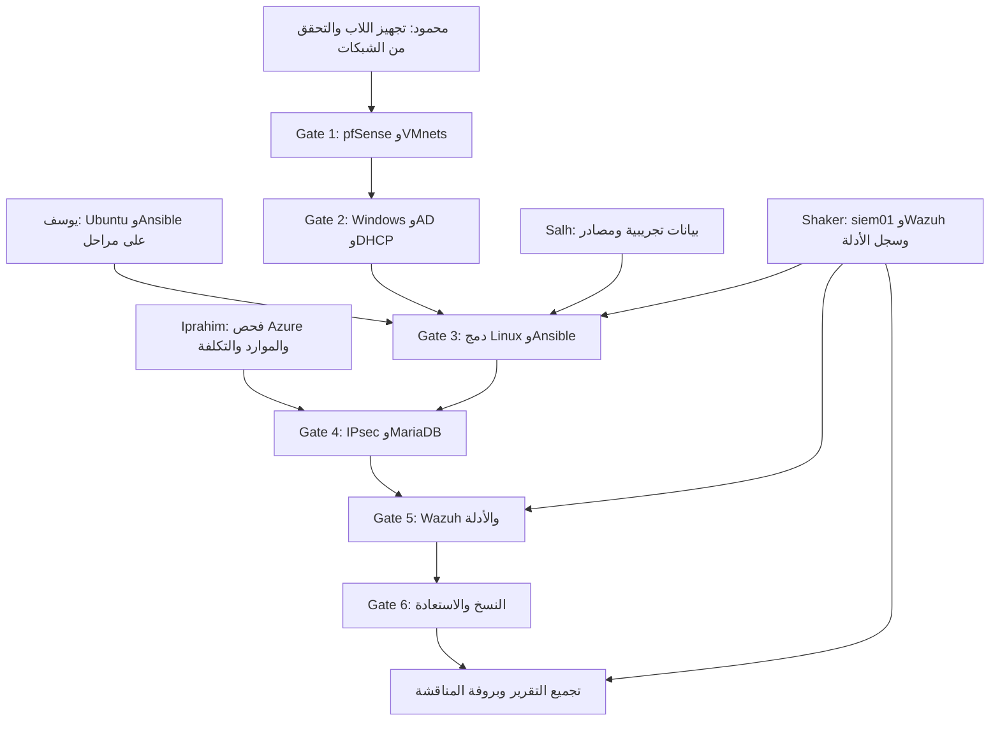

# Nile Care - دليل الدمج والنسخة النهائية لمحمود

لاب محمود (i7 جيل تاسع و16 GB RAM حسب مواصفاته) هو جهاز العرض لكل الـVMs المحلية. cloud-dr موجود على Azure ويتشغّل وقت عرض الـDR لو العرض لايف. جهّز نسخة واحدة من A وB وC وD وE على اللاب. سجّل RAM وCPU والمساحة المتاحة على درايف ملفات الـVM وإصدار VMware وحالة virtualization. سجّل كمان مسار المشروع الفعلي لو اللاب مفيهوش درايف E. المسارات المحلية مرجع للتنظيم، وعناوين الـIP والـVMnets تفضل حسب A.

## خريطة اعتماد المشروع

## 1. استقبال الشغل

1. استلم من كل عضو نسخة ثابتة من ملفاته مع تقرير التسليم. سجّل المسار والإصدار أو commit وتاريخ الاستلام. حط الملفات في فولدر استلام منفصل قبل نقلها للنسخة الأساسية.
2. افتح المخرجات واتأكد إن كل ملف موجود وبيعمل الغرض المكتوب. راجع مع شاكر أن الدليل يشير لنفس الجهاز والنسخة ووقت الاختبار. ارجع لصاحب الجزء لو الملف ناقص أو النتيجة غير قابلة لإعادة الفحص.
3. قارن أي إعداد شبكي أو قياس ذاكرة بمرجع A. استبدل قيم البيئة التجريبية بقيم A وقت الدمج. راجع المسارات، واجهات الشبكة والإصدارات. تحقق إن ملفات الإعداد المشتركة فيها placeholders للقيم الحساسة.
4. ضم الملفات اللي اتراجعت مجموعة واحدة كل مرة. سجّل التغيير واحتفظ بنسخة قبلها. لو التطبيق فشل، ارجع للنسخة السابقة، سجّل الرسالة وحدد مين يعالج السبب. يوسف يسلّم إعدادات قابلة لإعادة البناء؛ محمود ينفذ على لابه مع مراجعة يوسف عن بعد.

## 2. نقطة الربط في كل Gate

| المرحلة | هنركب إيه | دليل الاعتماد |
|---|---|---|
| قبل Gate 1 | مواصفات اللاب + B0 + نتائج VMware الحالية. استلم من شاكر أسماء الأدلة. | سعة اللاب والـVMs المناسبة لكل دفعة. نتيجة VMnet10/16 السابقة تخص الجهاز السابق. |
| Gate 1 | على لابك تحقق من VMnet8 وVMnet10/12/13/14/15/16/17. اربط كروت fw01 بترتيب B0 §3. استخدم 1 GB RAM وقرص 16 GB، واتبع B0 §8 بعد التثبيت. | صورة إعدادات كل شبكة، Console assignments، WebGUI من MGMT، Guest DNS/HTTPS، وlogged deny مطابق لمحاولة Guest → Servers. |
| Gate 2 | بعد اعتماد Gate 1، جهّز dc01 وخدمة DNS ونطاقات DHCP واجعل pfSense relay لـClinical/Admin/Guest حسب B0/B4. اختبر Windows/GPO في ترتيب B0/B4. | dcdiag وDNS والـleases الفعلية، وعزل Guest. AppLocker يحتاج دليله الخاص قبل استخدامه في السيناريوهات المرتبطة به. |
| Gate 3 | استلم من شاكر نظام siem01 الأساسي. يوسف يجهّز ويشغّل Ansible عليه. ضم ملفات يوسف وافحص inventory والـSSH وـWinRM حسب نطاقهم، ونفذ تشغيل Linux على دفعات. ضم بيانات Salh المعتمدة إلى EMR وPACS. | مخرجات syntax check وplaybook الفعلية لكل دفعة، نسخة الإعدادات، وقائمة الخدمات وعناوينها. Wazuh stack له Gate 5. |
| Gate 4 | استلم من Iprahim الـregion والـSKU والعناوين ومخرجات Azure. محمود وIprahim يتأكدوا إن الطرفين متطابقين في إعدادات IPsec. يوسف يجهّز مصدر MariaDB ثم Iprahim يجهّز replica. | حالة النفق من الناحيتين، ومطابقة اتجاه TCP 3306 من cloud-dr إلى emr01، ونتيجة تحديث بيانات اصطناعية وصلت للـreplica. |
| Gate 5 | شاكر يركّب Wazuh والـagents على دفعات ويقود فحص وصول الأحداث على لاب محمود. محمود يراجع Windows وSuricata على fw01، يوسف يراجع جانب Linux، وIprahim يراجع cloud-dr. | قائمة agents بحالتها ووقت التقاط كل دفعة، ودليل rule 100100 ومصدره. |
| Gate 6 | محمود يراجع Windows وpfSense backups، يوسف يراجع EMR dump والـrestic، وIprahim يراجع Blob وimmutability. شاكر يراجع نسخة إعدادات Wazuh ويوحّد التوقيت والأدلة. | الطوابع الزمنية والـsnapshot IDs وفحص استعادة البيانات. اعتمد Gate 6 بعد الدليل الفعلي للاستعادة. |

لو الـVM الموجودة على الجهاز السابق هتتنقل اختياريًا، سجّل إعداداتها، اقفلها بصورة سليمة، وانقل كامل الفولدر بعد مراجعة السعة. أعد إنشاء VMnets على اللاب وقارن العناوين والـNIC mappings ومعلومات حجوزات DHCP قبل التشغيل. النسخة الموجودة سابقًا ظهرت في `E:\NileCare\vms\vms1` باسم `FreeBSD 14 64-bit` وذاكرة `512 MB` في آخر مراجعة للملف. استخدم B0 كمرجع عند البناء على اللاب. آخر صور محاولات التثبيت أظهرت timeout لتنزيل package ثم mountroot panic. التثبيت والإصدار الفعلي لسه <PENDING>.

## 3. تعارضات سجلها قبل الاختبارات

| الموضع | المشكلة وأسلوب التعامل |
|---|---|
| C §1 | Windows shares تحتاج dc02، والقائمة الأصلية لا تشغّله. لو ضفته مع emr01 تبقى 11.5 GB. استخدم مجموعتين في ورقة التشغيل بعد تسجيلها. 1A Windows وRBAC: fw01 + dc01 + dc02 + win-client = 9.5 GB. 1B Linux وSSSD: fw01 + dc01 + emr01 = 5.5 GB. اربط أدلة الدفعتين بـFigure 9.1. |
| B-README Gate 3/4 وB5 §7 | Gate 3 يحتاج siem01 ليشغّل Ansible. عبارة تأجيل SIEM تخص Wazuh stack، فاستلم Ubuntu من شاكر وجهّز Ansible مع يوسف في Gate 3. راجع B5 §7.4 وحدد تشغيل مهام تثبيت الـagents ضمن Gate 5 وسجل الجزء اللي اتنفذ في كل مرحلة. |
| B-README Gate 6 وC §§0 و7 و8 | Gate 6 بيطلب نتيجة Scenario 8، وScenario 8 بعد رجوع Scenario 7، وScenario 7 مكتوب قبله اعتماد Gates 4–6. سجّل توضيح الترتيب قبل الاختبار. بعد Gate 4 و5 جهّز Gate 6 وسجله READY مع التأكد من النسخ وخطة الاسترجاع. نفّذ Scenario 7 تحت إشراف أصحاب الأجزاء، حقق الرجوع، ثم Scenario 8. بعد نتيجة الاستعادة المقبولة سجّل Gate 6 PASS. |
| B6 §3.2 وB8 §4 وC §7 | selectors المكتوبة تغطي Servers وMGMT، بينما تمرين التحويل يطلب HTTPS من Clinical/Admin إلى cloud-dr. عمل firewall allow وحده لا يضيف مسار جوه النفق. كمان الـdomain client يستخدم DNS بتاع AD. وثّق واختبر مسار التطبيقات ونتيجة DNS من win-client قبل التمرين. راجع selectors وملكية DNS مع Iprahim ويوسف قبل اعتماد أي تغيير. |
| C §8 | dc02 مذكور ضمن الأجهزة الشغالة، لكن خطوات استعادة EMR dump لا تشير له مباشرة. النتيجة مراجعة اعتمادية، ومسار B8 §2 الخاص بالـWindows منفصل. سجّل أي اعتماد فعلي زي DNS أو تخزين قبل تغيير مجموعة التشغيل. |
| C §§0 و9 وB5 §1 وB7 §§5 و8 | Nessus وLynis محتاجين baseline قبل التقوية. احفظه وقت بناء نفس الأهداف وسجّل نسخ الأدوات والنطاق والسياسة. قارن بعد التقوية بنفس النطاق. لو baseline مفقود سجل <PENDING> وسبب النقص لكل نظام. |

قبل أي failover أو restore، تأكد إن نسخة المعمل فيها بيانات تجريبية فقط، وإن النسخة المقصودة معروفة ويمكن قراءتها، وإن طريقة الرجوع متفق عليها. سجل 15 دقيقة كهدف replica و24 ساعة كهدف طريق الـdump حسب C، ودوّن القياس الفعلي لكل تمرين في حقله وبتوقيت النسخة المستخدمة. سجّل فرق نتائج الـstaging عن اللاب النهائي.

## 4. تجميع التسليم والمناقشة

| المستند النهائي | منين ييجي | مراجعة قبل الإصدار |
|---|---|---|
| Abstract وCh. 1 وCh. 11 | E مع Salh وMahmoud. حدّث Abstract وConclusion في الآخر. | فرّق بين هدف التصميم واللي اتنفذ واللي اتقاس. |
| Ch. 2 | Salh من الـtemplate وA §§9 و12 | assets وrisk register ومصدر كل claim. |
| Ch. 3–4 | محمود من A وB0/B4 | الـVLANs وVMnets والعناوين والـWindows evidence. |
| Ch. 5 و7 | يوسف يكتب Linux وAnsible، وشاكر يكتب Wazuh، ومحمود يراجع جانب firewall وSuricata وWindows. | الأسماء والعناوين والإصدارات والفرق بين planned وimplemented؛ أسماء الأشكال حسب B-README. |
| Ch. 6 و8 | Iprahim يكتب Azure، ومحمود يكتب Windows/pfSense، ويوسف يكتب replication وLinux backup. | نفس مسار الـVPN والنسخ في كل فصل، مع نتيجة الاستعادة الصحيحة. |
| Ch. 9 وAppendix C | شاكر يجمع نتائج كل مالك من C وevidence. | كل صف له دليل فعلي، أو حالة واضحة لو مش متاح. |
| Ch. 10 وReferences | D مع مراجعة Salh | البيانات التجريبية منفصلة عن ادعاءات الامتثال والمصادر الرسمية. |
| Appendices A وB وD | نسخ الإعداد والسكربتات المنقحة من أصحابها، وجدول [Appendix D](06-Appendix-D-task-allocation.md). | راجع الإصدارات وplaceholders والأسماء. |

1. شاكر يجمّع مسودة واحدة من الـtemplate، ويشيل guidance boxes، ويحدّث TOC والجداول والأشكال والـcross-references. محمود يراجع الأرقام والمسارات مع النسخة اللي هتتعرض عملي.
2. خلّي فولدر التسليم فيه التقرير، حزمة إعدادات من غير أسرار، وملخص الأدلة اللازمة. احفظ تقارير التسليم التفصيلية مع نسخة الفريق. افتح التقرير والـartifacts على لاب المناقشة قبل اعتماد النسخة.
3. بروفة العرض تمشي بالترتيب: محمود يشرح الشبكة وWindows، يوسف يشرح Linux وAnsible، Iprahim يشرح Azure والـDR، Salh يشرح البيانات والمصادر، وشاكر يشرح Wazuh ويربط النتائج بالأدلة. استعمل مجموعات التشغيل المعتمدة وحضّر نسخة من الأدلة المقاسة محليًا لأي جزء محتاج اتصال خارجي.
4. سجل إصدار النسخة النهائية، حالة كل Gate، البنود المعلقة، وصاحب كل نتيجة. أي قياس مستني اختبار يفضل <PENDING>.

## 5. Demo Power Schedule

في العرض النهائي، لاب يوسف مطلوب منه **0 VMs**. يوسف يجهز الأربع VMs في مرحلة التحضير، وبعد الدمج يشرح شغله من اللاب اللي عليه النسخة النهائية. لاب محمود عليه **9 VMs محلية**، وتشغيل العرض المقترح بحد أقصى **4 محلية في نفس الوقت**. شغّل الأجهزة المطلوبة للجزء الحالي وقفّل اللي خلصت دورها قبل بدء الدفعة اللي بعدها.

| جزء العرض | الـVMs على لاب محمود | العدد | RAM للـVMs |
|---|---|---:|---:|
| Windows والـDomain والـfile shares | fw01 + dc01 + dc02 + win-client | 4 | 9.5 GB |
| خدمات Linux من جهاز الـMGMT | fw01 + emr01 + pacs01 + portal01 | 4 | 4.75 GB |
| Wazuh ومراجعة الأحداث من الـMGMT | fw01 + dc01 + emr01 + siem01 | 4 | 9.5 GB |
| عرض DR لايف، حسب نتيجة البروفة | fw01 + dc01 + emr01 + win-client، ومعاهم cloud-dr على Azure | 4 محلية + 1 Azure | 9.5 GB محليًا قبل إيقاف emr01، و7.5 GB بعده |

دي دفعات العرض المقترحة. الاختبارات الكاملة تمشي حسب مجموعات التشغيل في C. أرقام RAM من A §5. جرّب الدفعات على لاب محمود قبل المناقشة وتأكد إن مسار تحويل الـDR وDNS شغالين لو هتعرضهم لايف.
